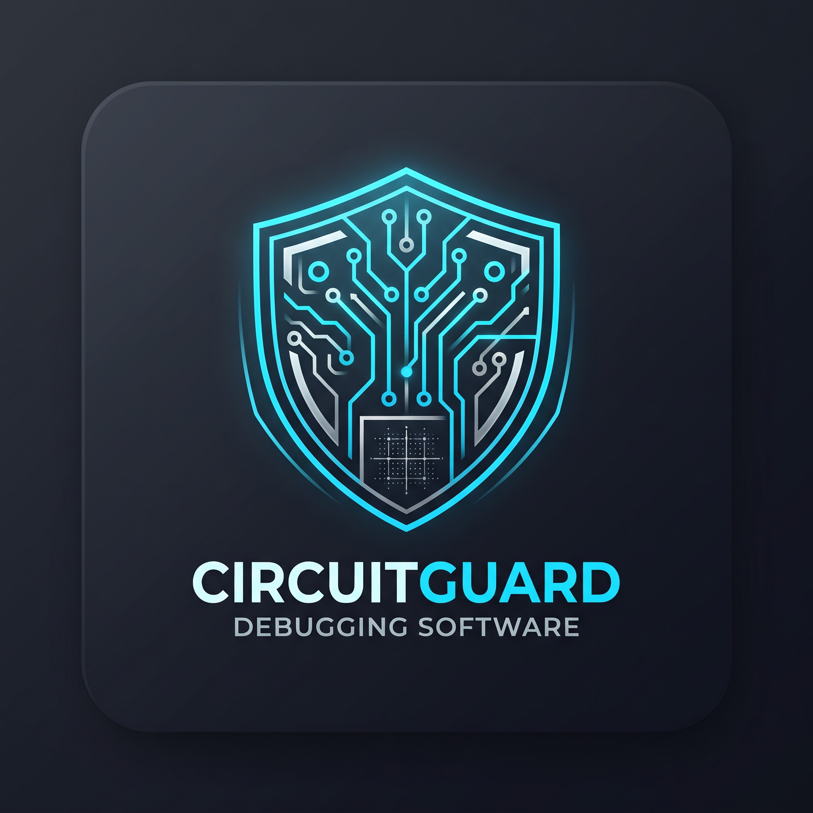

  

  # 🛡️ CircuitGuard Pro
  **Industrial PCB Layout Viewer & AI-Powered Diagnostic Suite**

  
  [-fcc624?style=for-the-badge&logo=linux&logoColor=black)](https://ubuntu.com/)
  
  
  

  

    <b>CircuitGuard</b> is a next-generation industrial EDA inspection tool designed for hardware engineers. Combining an Altium-inspired dark industrial interface with 100% offline local AI diagnostics, it detects design rule violations, trace anomalies, and layout bottlenecks before manufacturing.
  

  [📥 Download .deb Installer](https://github.com/Draxx143/project_pcb_problem_finder/releases/latest) • [🚀 Quick Start](#-installation) • [🧠 AI Diagnostics](#-ai-powered-diagnostics) • [🇮🇷 مستندات فارسی](#-معرفی-پروژه-فارسی)

---

## 📸 Interface Preview (نمای محیط صنعتی برنامه)

  

---

## ⚡ Key Industrial Features

| Feature | Description |
| :--- | :--- |
| **🎛️ Industrial EDA Interface** | Ergonomic dark-themed workspace inspired by **Altium Designer**, built for long hardware debugging sessions with zero eye strain. |
| **🧠 100% Local AI Engine** | Powered by **Ollama (qwen2.5-coder:7b)** running entirely on your local hardware—ensuring complete IP security for confidential PCB designs. |
| **🔍 Automated Fault Detection** | Identifies short circuits, clearance violations, unrouted nets, thermal bottlenecks, and signal integrity risks. |
| **⚡ High-Performance Core** | Built with CMake and optimized native libraries for lag-free zooming, panning, and multi-layer inspection. |
| **📦 Native Linux Packaging** | Ships as a standard .deb package with full GNOME/Ubuntu desktop integration and quick-launch diagnostic actions. |

---

## 🧠 AI-Powered Diagnostics

Unlike cloud-based tools that upload your proprietary hardware schematics to external servers, **CircuitGuard** processes everything locally:

1. **Netlist & Trace Analysis:** Evaluates copper pour clearances, trace widths, and via placements against industrial IPC standards.
2. **Interactive Hardware Assistant:** Ask the integrated qwen2.5-coder:7b engine to review specific board regions, suggest decoupling capacitor placements, or explain DRC errors in real time.
3. **Zero Latency & Offline Ready:** Works inside isolated laboratory networks without an internet connection.

---

## 🚀 Installation

### Option 1: Official .deb Package (Recommended for Ubuntu/Debian)
Download the latest installer from the [Releases](https://github.com/Draxx143/project_pcb_problem_finder/releases) page and install it via apt:

~~~bash
sudo apt install ./circuit-guard-1.0.0-Linux.deb
~~~

Once installed, launch **CircuitGuard** directly from your Ubuntu Application Menu!

### Option 2: Build from Source

~~~bash
git clone https://github.com/Draxx143/project_pcb_problem_finder.git
cd project_pcb_problem_finder
./setup_linux.sh
./run.sh
~~~

---

## 🇮🇷 معرفی پروژه (فارسی)

**CircuitGuard Pro** یک نرم‌افزار صنعتی و پیشرفته برای مشاهده، تحلیل و عیب‌یابی بردهای مدار چاپی (**PCB**) است. این نرم‌افزار با الهام از محیط کاربری حرفه‌ای **Altium Designer** طراحی شده و با بهره‌گیری از مدل هوش مصنوعی محلی **qwen2.5-coder:7b**، به مهندسان الکترونیک کمک می‌کند تا خطاهای طراحی، اتصالات کوتاه و مشکلات مسیرکشی (Routing) را پیش از تولید برد به صورت هوشمند شناسایی کنند.

### ✨ ویژگی‌های برجسته:
* **رابط کاربری صنعتی و مهندسی:** طراحی تاریک، مدرن و استاندارد برای کار طولانی‌مدت مهندسان سخت‌افزار.
* **هوش مصنوعی ۱۰۰٪ آفلاین و امن:** اجرای محلی مدل روی سیستم شما بدون نیاز به اینترنت و با حفظ کامل محرمانگی نقشه‌های صنعتی.
* **نصب آسان در اوبونتو:** ارائه شده به صورت پکیج استاندارد .deb و ادغام کامل با منوی برنامه‌های لینوکس.

---

## 📄 License

Distributed under the **MIT License**. See [LICENSE](LICENSE) for more information.

  Built with ⚡ by the <b>CircuitGuard Engineering Team</b>

